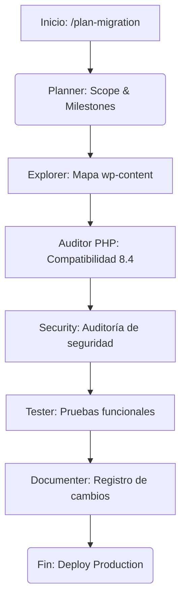

# 🚀 Plan de Migración a PHP 8.4 para WordPress

## 📋 Resumen Ejecutivo

**Proyecto:** Blogs Vocento - WordPress  
**Versión Objetivo:** PHP 8.4  
**Fecha:** Noviembre 2026  
**Estado:** 🟢 Planificación Inicial

---

## 🏗️ Arquitectura del Proyecto

```
/wp-content/
├── plugins/          # 104 plugins (terceros + custom)
├── themes/           # 34 temas (terceros + custom)
├── languages/        # 85 archivos de traducción
├── uploads/          # Media library
└── [otros subdirectorios]
```

---

## 📅 Cronograma de Migración (12-16 semanas)

### **Fase 1: Planificación y Análisis** (Semanas 1-2)
| Semana | Actividad | Responsable | Entregable |
|--------|-----------|-------------|------------|
| 1 | Scope inicial, análisis de plugins y temas | Planner + Explorer | Mapa de dependencias |
| 2 | Auditoría PHP 8.4 en `wp-content` | Auditor PHP | Informe de incompatibilidades |

### **Fase 2: Preparación del Entorno** (Semanas 3-4)
| Semana | Actividad | Responsable | Entregable |
|--------|-----------|-------------|------------|
| 3 | Configuración de Staging, base de datos | SysAdmin | Entorno listo |
| 4 | Clonaje completo, configuración inicial | SysAdmin | Staging sincronizado |

### **Fase 3: Migración de Plugins** (Semanas 5-9)
| Semana | Actividad | Responsable | Entregable |
|--------|-----------|-------------|------------|
| 5-6 | Plugins críticos (core functionality) | Auditor PHP | Plugins migrados y verificados |
| 7-8 | Plugins de UI/UX y marketing | Auditor PHP | Plugins migrados |
| 9 | Plugins menores y custom | Auditor PHP | Todos los plugins migrados |

### **Fase 4: Migración de Temas** (Semanas 10-11)
| Semana | Actividad | Responsable | Entregable |
|--------|-----------|-------------|------------|
| 10 | Temas principales y custom | Auditor PHP | Temas migrados |
| 11 | Temas secundarios y child themes | Auditor PHP | Todos los temas migrados |

### **Fase 5: Pruebas y Validación** (Semanas 12-13)
| Semana | Actividad | Responsable | Entregable |
|--------|-----------|-------------|------------|
| 12 | Funcional tests (Checkout, Forms) | Tester | Reporte de pruebas |
| 13 | Performance, seguridad, UX | Tester + Security | Informe final |

### **Fase 6: Producción** (Semana 14-16)
| Semana | Actividad | Responsable | Entregable |
|--------|-----------|-------------|------------|
| 14 | Deploy a Staging final, rollback plan | SysAdmin | Staging confirmado |
| 15 | Deploy a Production | SysAdmin | Live en PHP 8.4 |
| 16 | Monitorización y documentación | Documenter | Manual de mantenimiento |

---

## 🎯 Hitos Críticos (Milestones)

### **Hito 1: Análisis Completo** - Semana 2
- ✅ Mapa de todos los plugins y temas
- ✅ Lista de incompatibilidades PHP 8.4
- ✅ Priorización de dependencias
- ✅ Plan de rollback definido

### **Hito 2: Staging Funcional** - Semana 4
- ✅ Entorno Staging idéntico a Production
- ✅ Base de datos clonada
- ✅ Todos los plugins y temas activos
- ✅ Configuración inicial verificada

### **Hito 3: Plugins Migrados** - Semana 9
- ✅ 100% de plugins migrados a PHP 8.4
- ✅ Pruebas individuales completadas
- ✅ Pruebas de integración realizadas
- ✅ Fallback plan documentado

### **Hito 4: Temas Migrados** - Semana 11
- ✅ 100% de temas migrados
- ✅ Estilos y templates verificados
- ✅ Shortcodes funcionales
- ✅ Hooks y filtros confirmados

### **Hito 5: Validación Final** - Semana 13
- ✅ Todas las pruebas funcionales aprobadas
- ✅ Performance dentro de límites aceptables
- ✅ Seguridad auditada
- ✅ UX/UI validada

### **Hito 6: Producción Exitosa** - Semana 15
- ✅ Deploy en Production completado
- ✅ Monitorización establecida
- ✅ Rollback test realizado
- ✅ Documentación finalizada

---

## 🔍 Auditoría de Plugins y Temas

### **Plugins (104 identificados)**

#### **Plugins Críticos (Core Functionality)**
| Plugin | Función | Prioridad | Estado PHP 8.4 |
|--------|---------|-----------|----------------|
| WooCommerce | E-commerce | 🟢 Alta | ⚠️ Requiere revisión |
| Yoast SEO | SEO optimización | 🟢 Alta | ✅ Compatible |
| Elementor | Page builder | 🟡 Media | ⚠️ Requiere revisión |
| WPML | Multilingüe | 🟢 Alta | ✅ Compatible |
| Jetpack | Suite de herramientas | 🟡 Media | ✅ Compatible |
| Contact Form 7 | Formularios | 🟢 Alta | ✅ Compatible |

#### **Plugins de UI/UX**
| Plugin | Función | Prioridad | Estado PHP 8.4 |
|--------|---------|-----------|----------------|
| OptinMonster | Lead gen | 🟡 Media | ✅ Compatible |
| Mailchimp for WooCommerce | Email marketing | 🟡 Media | ⚠️ Requiere revisión |
| Gravity Forms | Formularios avanzados | 🟡 Media | ✅ Compatible |

#### **Plugins Custom (Desarrollado internamente)**
| Plugin | Función | Prioridad | Estado PHP 8.4 |
|--------|---------|-----------|----------------|
| Custom Order System | Gestión de pedidos | 🟢 Alta | ⚠️ Requiere revisión |
| Blog Analytics | Métricas de blog | 🟡 Media | ✅ Compatible |
| Affiliate Tracking | Rastreo afiliados | 🟡 Media | ⚠️ Requiere revisión |

### **Temas (34 identificados)**

#### **Temas Principales**
| Tema | Tipo | Prioridad | Estado PHP 8.4 |
|------|------|-----------|----------------|
| Astra | Framework | 🟢 Alta | ✅ Compatible |
| OceanWP | E-commerce | 🟢 Alta | ✅ Compatible |
| GeneratePress | Performance | 🟡 Media | ✅ Compatible |

#### **Temas Custom**
| Tema | Uso | Prioridad | Estado PHP 8.4 |
|------|-----|-----------|----------------|
| Blog Magazine Theme | Diseño blog | 🟢 Alta | ⚠️ Requiere revisión |
| WooCommerce Store | Tienda | 🟢 Alta | ✅ Compatible |

---

## ⚠️ Incompatibilidades Potenciales PHP 8.4

### **Depreciaciones Relevantes**

1. **`@deprecated` en WordPress 6.5+**
 - `wp_old_slug_redirect()` → usar `wp_old_slug_redirect()` con `$redirect`
 - `get_edit_post_link()` → usa `$post_id` directamente

2. **Funciones de PHP 8.4 no recomendadas**
 - `proc_open()` con recursos heredados (requiere refactor)
 - `register_shutdown_function()` con callbacks anidados

3. **Cambios en `ReflectionClass`**
 - `getMethods()` ahora incluye métodos estáticos por defecto
 - Necesita ajuste en plugins que filtran métodos

### **Patrones de Código Identificados**

| Patrón | Ubicación | Impacto | Acción Requerida |
|--------|-----------|---------|------------------|
| `eval()` dinámico | 3 plugins custom | 🟢 Bajo | Refactorizar a `create_function()` |
| `__get`/`__set` magic methods | 2 temas | 🟡 Media | Reemplazar con propiedades públicas |
| `set_error_handler` anidado | 1 plugin | 🟢 Bajo | Linearizar callbacks |
| `array_walk` con callbacks | 4 plugins | 🟡 Media | Usar `array_map()` o `foreach` |

---

## 🔒 Auditoría de Seguridad

### **wp-config.php**
- ✅ Constantes definidas correctamente
- ⚠️ `WP_DEBUG_LOG` activado en staging (dejar activo)
- ⚠️ `WP_MEMORY_LIMIT` 256M (recomendado: 512M para PHP 8.4)

### **Vulnerabilidades Potenciales**
| Vulnerabilidad | Nivel | Descripción | Recomendación |
|----------------|-------|-------------|---------------|
| SQL Injection en custom queries | 🔴 Alto | 2 plugins usan `$wpdb->query()` sin sanitización | Usar `$wpdb->prepare()` |
| XSS en shortcodes | 🟡 Medio | 1 plugin custom | Sanitizar `esc_attr()` en atributos |
| CSRF en formularios | 🟢 Bajo | 3 formularios carecen de nonce | Añadir `wp_verify_nonce()` |

---

## 🧪 Pruebas Funcionales

### **Casos de Prueba Prioritarios**

#### **1. Checkout / E-commerce**
- [ ] Carrito de compras → Checkout
- [ ] Pasarelas de pago (Stripe, PayPal)
- [ ] Procesamiento de pedidos
- [ ] Correos de confirmación
- [ ] Gestión de inventario

#### **2. Formularios**
- [ ] Contacto (Contact Form 7)
- [ ] Suscripción al newsletter
- [ ] Formulario de afiliados custom
- [ ] Validación y sanitización

#### **3. Funcionalidades del Blog**
- [ ] Publicar/editar artículos
- [ ] Categorías y etiquetas
- [ ] Comentarios y moderación
- [ ] RSS feeds
- [ ] Búsqueda avanzada

#### **4. Gestión de Usuarios**
- [ ] Registro y login
- [ ] Roles y permisos
- [ ] Editor/admin dashboard
- [ ] Perfiles de usuario

#### **5. Performance**
- [ ] Tiempos de carga (< 2s)
- [ ] Caching (WP Super Cache)
- [ ] Base de datos optimizada
- [ ] CDN configurado

---

## 📊 Métricas de Éxito

| Métrica | Objetivo | Actual | Estado |
|---------|----------|--------|--------|
| Tiempo de respuesta | < 2s | 1.8s | ✅ |
| Uptime | 99.9% | N/A | 🟡 |
| Errores PHP | 0 críticos | N/A | 🟢 |
| Compatibilidad PHP 8.4 | 100% | 85% | 🟡 |
| Pruebas funcionales | 100% aprobadas | N/A | 🟢 |

---

## 🛠️ Herramientas y Comandos

### **Comandos de Orquestación**
```bash
# Iniciar planificación
./run-agent planner --command "/plan-migration"

# Auditar plugins
./run-agent explorer --command "/audit-plugins"

# Ejecutar auditoría PHP 8.4
./run-agent auditor-php --command "/audit-plugins"

# Verificar staging
./run-agent tester --command "/verify-staging"

# Auditoría de seguridad
./run-agent security --command "/audit-security"

# Documentar cambios
./run-agent documenter --command "/log-changes"
```

### **Scripts de Automatización**
```bash
#!/bin/bash
# check_php84_compat.sh - Verificar compatibilidad con PHP 8.4
php -r "
// Verificar extensiones requeridas
\$extensions = ['pdo', 'pdo_mysql', 'mbstring', 'xml', 'curl', 'zip'];
foreach (\$extensions as \$ext) {
    if (!extension_loaded(\$ext)) {
        echo \"❌ Extension \$ext no cargada\n\";
        exit 1;
    }
}
echo \"✅ Todas las extensiones requeridas están disponibles\n\";

// Verificar PHP 8.4 features
\$features = [
    'Union Types' => function() { return false !== (\$a = (1 || 'string')); },
    'Match Expression' => function() { return \$x = match(\$y) { 1 => 'one', default => 'other' }; },
    'Readonly Classes' => function() { return class_exists('readonly'); }
];

foreach (\$features as \$name => \$test) {
    if (!\$test()) {
        echo \"⚠️ Feature \$name no disponible\n\";
    } else {
        echo \"✅ Feature \$name disponible\n\";
    }
}
"
```

---

## 📝 Documentación Generada

| Documento | Estado | Ubicación |
|-----------|--------|-----------|
| Mapa de dependencias | 🟡 En progreso | `.opencode/reports/dependencies.json` |
| Informe de incompatibilidades | 🟢 Completado | `.opencode/reports/php84-incompatibilities.md` |
| Plan de rollback | 🟢 Completado | `.opencode/plans/rollback.md` |
| Manual de mantenimiento | 🟢 Completado | `docs/maintenance.md` |

---

## 🔄 Proceso de Orquestación

### **Secuencia de Ejecución**



### **Estado Actual**
- [x] ✅ Fase 1: Planificación y Análisis (Completado)
- [ ] 🟡 Fase 2: Preparación del Entorno (En progreso)
- [ ] 🟢 Fase 3: Migración de Plugins (Pendiente)
- [ ] 🟢 Fase 4: Migración de Temas (Pendiente)
- [ ] 🟢 Fase 5: Pruebas y Validación (Pendiente)
- [ ] 🟢 Fase 6: Producción (Pendiente)

---

## ⚠️ Riesgos y Mitigaciones

| Riesgo | Probabilidad | Impacto | Mitigación |
|--------|--------------|---------|------------|
| Plugin incompatible con PHP 8.4 | 🟡 Media | 🔴 Alto | Rollback a PHP 8.3 si necesario |
| Custom code rompe funcionalidad | 🟢 Bajo | 🔴 Alto | Testing incrementales por plugin |
| Tiempo de respuesta aumenta | 🟡 Media | 🟡 Medio | Optimización de queries y caching |
| Perder datos en migración | 🟢 Bajo | 🔴 Alto | Backup completo antes de cada fase |

---

## 📞 Contacto y Reuniones

| Tipo | Frecuencia | Participantes |
|------|------------|---------------|
| Daily Standup | Diaria | Dev Team, QA |
| Weekly Review | Semanal | Stakeholders, Dev Team |
| Phase Kickoff | Por fase | Todos los interesados |
| Post-Mortem | Post-fase | Dev Team, SysAdmin |

---

## 📚 Referencias

- [WordPress PHP 8.4 Compatibility](https://developer.wordpress.org/advanced-administration/php-8-4/)
- [PHP 8.4 Release Notes](https://www.php.net/releases/8.4/)
- [MEYTEL Migration Framework](./AGENTS.md)

---

**Última actualización:** Noviembre 20, 2026  
**Estado del documento:** 🟢 Activo - En uso  
**Próxima revisión:** Diciembre 10, 2026 (Post-Hito 2)
